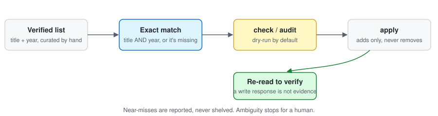

# plex-collection-curator

Build and audit Plex collections from a **verified list** — never from
keyword search.

## The problem

Most collection tools work backwards: they search your library for keywords
("Christmas", "Santa", "Holiday") and add whatever comes back. Search
results are not verification. They return near-matches, same-title
different movies, and wrong-year remakes — and a naive tool shelves all of
them. (A real example: a library where "The Lodge" matched an obscure
same-title short, while the actual film sat on disk unmatched. Exact title
plus exact year is the difference.)

This tool inverts the flow:

1. **You curate the list** — one title + year per entry. The human (or a
   very careful process) is the verification step.
2. **The tool matches exactly** — normalized title equality *and* year
   equality, or the entry is reported missing. Near-misses are never added.
3. **Dry-run by default** — `check` mode changes nothing.
4. **Apply verifies itself** — after adding, it re-reads the collection
   and proves every added item is actually a member before reporting
   success. A write response is not evidence; a re-read is.



## Usage

Stdlib-only Python 3. No dependencies.

```bash
export PLEX_URL="http://your-server:32400"
export PLEX_TOKEN="your-token"   # never printed or stored by the tool

# Report only: found / missing / ambiguous per entry
python3 curator.py --list lists/christmas-movies.csv --collection "The Christmas Shelf"

# Also report collection members that are NOT on the list (drift)
python3 curator.py --list lists/christmas-movies.csv --collection "The Christmas Shelf" --mode audit

# Add the found-but-unshelved items (creating the collection if needed), then verify
python3 curator.py --list lists/christmas-movies.csv --collection "The Christmas Shelf" --mode apply
```

If you have several movie libraries, pass `--library NAME`.

## List format

CSV with a header, or plain lines — both are just title + year:

```csv
title,year
Elf,2003
"Home Alone 2: Lost in New York",1992
```

```text
# comments and blank lines are fine
Elf (2003)
Krampus (2015)
```

`lists/christmas-movies.csv` is a worked example: a Christmas movie shelf
curated by hand, title by title — a canonical core plus a hand-picked
horror set and specials, exactly as the shelf itself grew.

## Live verification (2026-11-13)

This tool was run live against a real 406-movie library, and the live
run earned its keep:

- **Check and audit were exact**: 21 list entries → 12 in the library,
  9 genuinely missing (confirmed title-by-title against the server —
  including one believed-owned title that simply isn't there), and the
  audit's extras were precisely the shelf's hand-added titles, which were
  then added to the list.
- **The first apply attempt failed**: this server rejects the
  `library:///library/metadata/…` item URI form with HTTP 400 (and
  accepts a create-collection request while silently ignoring that
  form's seed item). The tool now uses the
  `server://<machineId>/com.plexapp.plugins.library/library/metadata/…`
  form, with the machine ID read from `/identity` — after which
  create, adds, and membership re-reads all verified end-to-end on a
  scratch collection, deleted afterwards.

Lesson kept in the code as a comment: a write API returning success is
not evidence the write landed. Re-read.

## Since then (Nov 23, 2026)

The library kept growing past the 406 movies of the live run (498 titles
tracked in the library manager as of Nov 21), and the same exact-match,
add-only, verify-after-write discipline now maintains **21 collections**:

- **Movies (10):** The Christmas Shelf (90+), Kafkaesque (23),
  Psychological Thrillers (39), Stoner Flicks, Time Loops, Dream Logic,
  Zombies, One Location, Liminal Spaces, Doubles & Impostors (11).
- **TV, show-level (11):** Best of Eps, Best of TV, Christmas Episodes,
  Simpsons Golden Era, Britcoms & Imports (19), Adult Animation (21),
  Sketch & Chaos (13), Limited Series (10), One Season Wonders (7),
  Dystopias & Dark Futures (9), True Crime & Dark Docs (6).

Two honest footnotes. The TV shelves are show-level collections; the
episode-level addressing discussed under Scope is still unbuilt. And a
scheduled watch now applies the same add-only rule on its own: five
requested stoner comedies are being shelved into Stoner Flicks as their
files land (9 titles in, 5 to go), each addition verified by re-read
before it counts. Three further shelves (One Bad Night, Cults &
Communes, Body Horror) are designed and deliberately unbuilt — curation
stays a decision, not a reflex. The test suite still passes: 8 tests, OK.

## What the modes report

- **MISSING** — no exact title+year match in the library. The tool never
  substitutes a near-match.
- **AMBIGUOUS** — more than one exact match (duplicate files). Skipped;
  a human decides.
- **EXTRA** (audit) — in the collection but not on your list. Drift from
  manual additions or looser tooling, surfaced instead of silently kept.
- **ADDED** (apply) — added and confirmed present on a fresh re-read.
  Anything that doesn't land is reported FAILED with a non-zero exit.

## Scope and limits

- Movies, one library section. TV episodes are the obvious next step and
  are deliberately out of scope for now — episode collections need
  show/season/episode addressing, not title+year.
- Adds only. The tool never removes anything; EXTRA items are reported
  for a human to deal with.
- Matching is exact after case/whitespace/apostrophe normalization.
  If your library stores a title differently ("The Lodge" filed under a
  localized name), the entry reports MISSING — fix the list or the
  metadata, don't loosen the matcher.

## Tests

`tests/test_curator.py` runs the full check/audit/apply flow against a
stub Plex client seeded with the traps this tool exists to defeat —
a same-title wrong-year item, a missing title, and a collection with an
unlisted extra:

```bash
python3 -m unittest discover -s tests
```

## Origin

Distilled from a real home-library curation workflow in which a Christmas
collection of 90+ items was rebuilt from a hand-verified list after a
keyword-built version proved unreliable — the rebuild found the shelf
both over- and under-inclusive. The list in `lists/` is that shelf's
full movie set as of the live audit above.

---

*By Stuart Rutty. MIT licensed — see [LICENSE](LICENSE).*
